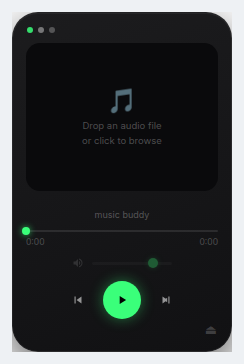

# Music Buddy

[](https://github.com/menamefilip/music-player/actions/workflows/ci.yml)

Music Buddy is a compact Electron desktop audio player and visualizer. It plays audio files you choose from your computer and visualizes the playing track.



> Chromium preview of the actual UI HTML in its empty state; no audio is loaded.

## Requirements

- Git
- Node.js 22.12.0 or newer, with npm
- A desktop environment supported by Electron

## Install and run

```bash
git clone https://github.com/menamefilip/music-player.git
cd music-player
npm ci
npm start
```

## Use

- Select a local audio file with the file picker, or drag and drop one onto the widget. Supported formats depend on Electron/Chromium.
- Playback loops the selected track. Use the controls to play/pause, seek, and adjust volume.
- The frequency spectrum shows 28 bars that react to the selected file's audio.
- The frameless, always-on-top window is **220 × 340 px** and opens near the lower-right of the display; drag it to move it.
- Music Buddy plays local audio files only. It does not capture microphone or system loopback audio.

The renderer runs sandboxed, with Node.js integration disabled and context isolation enabled. Music Buddy has no preload bridge and does not inject `os.homedir()` into the renderer.

## Development checks

```bash
npm test
node --check main.js
```

The test suite uses Node.js's built-in test runner and does not require additional test dependencies. These are repository contract checks; they do not launch the Electron GUI or test playback end-to-end.

## License

MIT. See [LICENSE](LICENSE).
